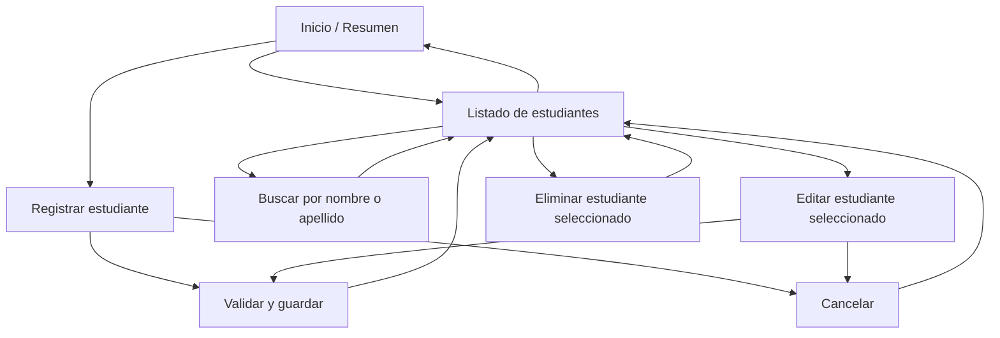

# Sistema de gestión de estudiantes

Aplicación de escritorio en Java Swing para registrar estudiantes, buscar por nombre o apellido, editar su información y eliminar registros. El formulario valida los campos y genera una matrícula automáticamente.

## Ejecutar

Desde esta carpeta, compila las clases y ejecuta la aplicación:

```powershell
javac -d bin src\*.java
java -cp bin SistemaGestionEstudiantes
```

Requiere un JDK instalado. No utiliza dependencias externas.

## Navegabilidad



La barra lateral permite acceder a Inicio, Estudiantes y Registrar estudiante. Para editar o eliminar, selecciona primero un registro de la tabla.

## Datos del estudiante

Nombre, apellido, correo electrónico y carrera son obligatorios; el teléfono es opcional. Los registros se mantienen en memoria y se reinician al cerrar la aplicación. La persistencia en archivo o base de datos puede añadirse en una siguiente etapa.
